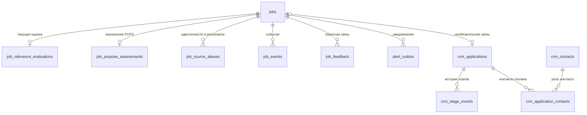

# Сущности и связи

[Документация](index.md) · [Карта проекта](project-map.md) · [Методы и точки входа](methods.md)

Срез текущей рабочей копии на **19.10.2026**. Это справочник важных полей и
границ ответственности; полный перечень полей задаёт связанный Python-код.
Таблицы ниже описывают контракт программы, а не проверенное содержимое рабочей БД.

## Четыре вещи, которые нужно различать

| Понятие | Что означает | Где смотреть |
| --- | --- | --- |
| `JobRecord` | Нормализованное объявление, полученное адаптером: факты источника и текст | [models/job.py](../src/job_intake/models/job.py) |
| Вакансия / `JobORM` | Сохранённая идентичность объявления, последнее содержание, наблюдения и результаты обработки | `jobs`, [storage/models.py](../src/job_intake/storage/models.py) |
| `JobEvaluation` | Машинная оценка объявления по назначенной роли: решение, баллы, ограничения и hiring eligibility | В памяти; затем `jobs` и `job_relevance_evaluations` |
| Отклик / `ApplicationORM` | Личная работа с компанией: этап, контакты, следующее действие и история | `crm_applications`, [crm/models.py](../src/job_intake/crm/models.py) |

Обнаруженная вакансия ещё не является откликом. Отклик может существовать без
вакансии в intake: его `job_uid` допускает `NULL`. При удалении связанной вакансии
внешний ключ задан как `ON DELETE SET NULL`, чтобы сохранить историю отклика.

## Схема хранения

Все показанные таблицы используют общий SQLAlchemy `Base` и настроенную SQLite HR.
По умолчанию путь — `data/local/job_intake.db`; фактический задаётся конфигурацией
и `JOB_INTAKE_DATABASE_URL`. `source_runs` хранит наблюдения источников отдельно,
без внешнего ключа на вакансию. У `crm_companies` также нет внешних ключей на
отклики или контакты: их поле `company` — текст, а не `company_id`.

## Вакансия и её идентичность

### `JobRecord`: входной контракт адаптеров

Обязательны `source`, `company`, `title`, `original_url`. Важные дополнительные поля:

- `apply_url`, `source_job_id`, `posted_at` — ссылка отклика и идентификаторы источника;
- `location_text`, `remote_text`, `employment_type`, `salary_text`, `timezone_text` —
  исходные условия, ещё не вывод о возможности найма;
- `description_raw`, `description_clean` — исходный и очищенный текст;
- `status` — `open`, `closed` или `unknown`; значение по умолчанию — `open`;
- `source_metadata` — сведения адаптера, в том числе полнота описания и provenance;
- `annotation` — производный результат разметки, отдельно от фактов источника.

Поля с `_` — внутренний кэш и защита согласованности записи: они не являются
публичными фактами или полями source snapshot. Контракт адаптеров возвращает
`list[JobRecord]`: [adapters/base.py](../src/job_intake/adapters/base.py).

### `JobORM`: сохранённая вакансия

| Группа | Основные поля | Зачем нужны |
| --- | --- | --- |
| Идентичность | `id`, `job_uid`, `fingerprint`, `content_hash` | Внутренний числовой PK, стабильная ссылка и обнаружение повторов/изменений |
| Исходник | Поля `JobRecord`, `source_metadata` | Последнее принятое содержание объявления |
| Производные результаты | `annotation`, `role_label`, `role_classification`, `fit_score`, `tier`, `filter_decision`, eligibility | Текущее состояние обработки для запросов и UI |
| Наблюдение | `first_seen_at`, `last_seen_at`, `source_revision` | Когда видели объявление; защита от сохранения оценки поверх изменившегося исходника |
| Исчезновение | `missing_since`, `missing_successes`, `missing_verified_seconds`, `missing_last_checked_at`, `last_complete_seen_at` | Доказательства отсутствия в полных успешных снимках доски |
| Личный архив | `archived_at`, `archive_version` | Скрытие вакансии с проверкой версии, независимо от закрытия объявления |

`JobDeduplicator` строит первичную идентичность из `source + source_job_id`, затем
канонического URL, затем fingerprint. `JobSourceAliasORM` (`job_source_aliases`)
связывает дополнительные доказанные идентичности с каноническим `job_uid`:
`alias_key`, `kind`, `provenance`. Известные ATS учитывают доску и идентификатор
реквизиции; конфликт aliases требует согласования, а не произвольного объединения.
См. [dedup.py](../src/job_intake/storage/dedup.py),
[aliases.py](../src/job_intake/storage/aliases.py).

Закрытие, архивирование и стадия CRM — разные состояния. Отсутствие в поисковой
выдаче или сбой адаптера не доказывают закрытие. Автоматическое закрытие по
исчезновению требует полных успешных наблюдений доски и выдержки порогов;
повторное появление может открыть запись, закрытую именно по этой причине.
См. [source_lifecycle.py](../src/job_intake/storage/source_lifecycle.py).

### Хеши отвечают на разные вопросы

| Поле | Назначение |
| --- | --- |
| `job_uid` | Какая это сохранённая вакансия |
| `fingerprint` | Дополнительный отпечаток содержания для поиска повторов |
| `content_hash` | Изменилось ли содержание, учитываемое intake при сохранении |
| `source_hash` | Совпадает ли source-контракт, к которому привязаны gold/discovery и provenance |
| `annotation_input_hash` | Совпадает ли фактический вход разметки: source units и признаки полноты |
| `prediction_source_hash` | Совпадает ли вход purpose: вход разметки и статус вакансии |

Хеши не взаимозаменяемы. В частности, изменение наблюдений сбора может не менять
вход модели. Точные контракты: [annotation/text.py](../src/job_intake/annotation/text.py),
[input_contract.py](../src/job_intake/annotation/input_contract.py),
[purpose.py](../src/job_intake/purpose.py).

## Роль, релевантность, eligibility и назначение

| Измерение | Вопрос | Поля / значения |
| --- | --- | --- |
| Роль | Какую профессию описывает объявление? | `role_label`, `role_classification`: label, версия, метод, статус, основание и хеши исходника |
| Релевантность | Насколько задачи соответствуют критериям назначенной роли? | `deterministic_score`, `semantic_score`, `raw_fit_score`, `fit_score`, `score_cap_reasons` |
| Маршрутизация | Что делать с результатом обработки? | `decision`: `pass`, `reject`, `review`; `tier`: `A`, `B`, `C`; `bucket` |
| Hiring eligibility | Подтверждают ли условия объявления допустимость найма? | `eligibility_status`: `eligible`, `ineligible`, `unknown`; evidence status: `confirmed`, `blocked`, `unconfirmed` |
| Назначение | Подходит для следующей работы P1 и/или практики интервью P2? | Независимые `human_p1`, `human_p2`, `predicted_p1`, `predicted_p2`: `suitable`, `unsuitable`, `unknown` |

Классификатор определяет одну роль по заголовку и обязанностям, затем применяется
её профиль оценки. Балл не определяет профессию. Eligibility не восстанавливается
из общего `decision`: `review` может относиться к другим неопределённостям.
P1/P2 не являются переводом категорий A/B/C.

### `SearchStream`, `EvaluatedJob` и текущая оценка

`SearchStream` объединяет стабильный `id`, `name`, контекст, запросы `keywords`,
названия ролей `titles`, правила `rules`, scoring и версии. Это исполняемый
конфигурационный профиль, а не запись о намерении пользователя. Поля
`query_version` и `version_components` отделяют изменение поиска от версий
обработки. Источник: [profiles.py](../src/job_intake/profiles.py),
файлы [rules.yaml](../config/rules.yaml) и [search_profiles.yaml](../config/search_profiles.yaml).

`EvaluatedJob` передаёт вместе `record`, `evaluation`, выбранные `profile_id`,
`profile_name`, `profile_version`, `role_classification`, `version_components`.
`JobEvaluation` также хранит объяснения, сигналы, блокеры, риски и audit log.

`JobProfileEvaluationORM` сохраняется в **`job_relevance_evaluations`**.
Несмотря на имя класса и plural relationship `profile_evaluations`, ограничение
`UNIQUE(job_uid)` и репозиторий допускают **одну текущую оценку на вакансию**.
Поля `profile_version`, `content_hash`, `classification_version`,
`classification_source_hash`, `llm_cache_key` нужны для проверки актуальности.
Историческая таблица `job_profile_evaluations` оставлена для старой модели и не
служит источником текущего балла. См. [storage/models.py](../src/job_intake/storage/models.py),
[repository.py](../src/job_intake/storage/repository.py).

### `JobPurposeAssessmentORM`: P1 и P2

В `job_purpose_assessments` ключ — `job_uid`; на вакансию приходится не более
одной строки. Машинная часть содержит `predicted_p1`, `predicted_p2`,
`practice_suitability` (в текущем предсказании равно `predicted_p2`),
`prediction_reason`, `prediction_source_hash`, `rubric_version`.
Человеческая часть — `human_p1`, `human_p2`, `human_note` и отдельные source/rubric
pins для каждого ответа. `version` защищает запись от конкурентных изменений.

Сохранение предсказания обновляет машинные поля. Ручной ответ сохраняется отдельно
с проверкой `expected_version` и `source_hash`. При сериализации его pins
сравниваются с сохранённым `prediction_source_hash` и текущей версией рубрики;
расхождение возвращается как stale. Это не удаляет ответ и не превращает
предсказание в человеческое решение.
Контракт и алгоритм: [purpose.py](../src/job_intake/purpose.py).

## Разметка и человеческий эталон

### Machine annotation: units → claims → summary

`annotation` — JSON-поле `JobRecord`/`jobs`, а не отдельная ORM-таблица. Его
создаёт [VacancyAnnotator](../src/job_intake/annotation/service.py).

| Объект | Важные поля | Правило доверия |
| --- | --- | --- |
| Source unit | `unit_id`, `field`, `section`, `text` | Ссылка на конкретный фрагмент входа |
| Claim | `claim_id`, `kind`, `value`, `unit_id`, `source_snippet`, `requirement`, `polarity`, `is_inference` | Цитата должна дословно находиться в указанном unit |
| Review | `review_status`, `review_notes`, `evidence_warnings` | Проверка привязывается к точному `claim_id`; не переписывает исходное доказательство |
| Summary | `knowns`, `unknowns`, `contradictions`, `coverage`, `supported_claim_ids`, `search_focus` | В knowns проходят поддержанные claims без inference, warnings и противоречий |

Claim сначала получает `UNREVIEWED`. Допустимые результаты review:
`SUPPORTED`, `WEAKLY_SUPPORTED`, `ANECDOTAL`, `CONFLICTING`, `UNSUPPORTED`,
`NEEDS_VERIFICATION`. Наличие цитаты подтверждает происхождение, но само по себе
не подтверждает смысл вывода. Отсутствие факта сохраняется как неопределённость.
Полная схема и проверки: [annotation/schema.py](../src/job_intake/annotation/schema.py).

### Human gold: самостоятельный JSONL-контракт

`vacancy-tags-v2` — ручной эталон уровня вакансии:

- привязка: `job_uid`, `source_hash`, `text_version`, необязательный source snapshot;
- решения: `role_label`, `relevance` от 0 до 3, `gate_outcome`
  (`eligible`, `ineligible`, `unknown`);
- доказательства и происхождение ответа: `tags` с `value`/`quote`, `method`
  (`blind`/`assisted`), `labeled_at`, `notes`, необязательный `label_scope`.

Шаблон может содержать незаполненные решения; такой шаблон ещё не эталон.
Machine claims и их `SUPPORTED` не являются human gold. Gold `relevance` также
не равен `fit_score`, а gold `gate_outcome` не равен автоматически текущей
машинной eligibility. Ответы P1/P2 в `job_purpose_assessments` — отдельный контракт
и не подменяют эти поля gold.

Gold хранится в JSONL, отдельно от SQLite HR; обычный путь CRM —
`gold/vacancy-tags-v2-labeled.jsonl` рядом с БД, с возможностью явного выбора пути.
Схема: [gold.py](../src/job_intake/annotation/gold.py),
[JSON Schema](schemas/vacancy-tags-v2-gold.schema.json).
Порядок разметки: [vacancy-gold-labeling.md](vacancy-gold-labeling.md).

## Источники и discovery

`SourceDefinition` (`name`, `type`, `enabled`, `params`) задаёт подключение
адаптера в конфигурации: [settings.py](../src/job_intake/config/settings.py).
Это не discovery candidate и не строка вакансии.

Наблюдение адаптера содержит `scope`, `status`, `snapshot_complete`, найденные IDs
и URLs, ошибки, coverage и лимиты. `SourceRunORM` сохраняет основные поля
`source`, `status`, `snapshot_complete`, `record_count`, `details`, времена начала
и завершения в `source_runs`. Частичный успешный сбор может дать полезные записи,
но не становится доказательством полноты доски.

Discovery ведёт собственные артефакты до импорта в HR:

| Артефакт | Смысл и основные данные |
| --- | --- |
| `plan.json` | `discovery-plan-v1`: objective, ручные seeds/counterexamples, queries, исключения, критерии и ограничения |
| `discoveries.jsonl` | Поисковые находки: URL/hit и связь с запросами, затем outcome обработки |
| `candidates.jsonl` | Кандидаты: `job_uid`, неизменяемый `source`, `source_hash`, priority, evidence, observations, ranking method, objective |
| `manifest.json` | `discovery-run-v1`: статус, лимиты, расходы, счётчики, ошибки, provenance конфигурации |
| `selection.jsonl`, `review-duplicates.jsonl`, `audit-rejected.jsonl` | Решения отбора, повторы для очереди чтения и выборка отклонённых результатов |
| `batch.json`, `labels.jsonl` | Зафиксированная очередь ручной проверки и ответы по схеме human gold; digest candidates связывает её с исходниками запуска |
| Promotion draft | `discovery-promotion-v1`: source snapshot/hash, objective P1/P2, idempotency key, ссылка на проверенный человеческий ответ |

Discovery `job_uid` вычисляется через `candidate_uid()` из нормализованной URL
identity. При импорте канонический `job_uid` HR может отличаться. Связь сохраняет
`job_source_aliases` с `kind="discovery_promotion"` и исходным snapshot/ответом в
provenance; human labels остаются в своём журнале. Объединение похожих текстов для
очереди чтения также не переносит eligibility или ручные ответы между региональными
объявлениями.

Реестр `DiscoveryRegistry` — **другая SQLite**, по умолчанию
`.discovery-registry.sqlite3` в родительской папке запусков. Его таблица `cache`
содержит `key`, `stage`, `status`, `payload`, `created`, `expires`, `origin`:
это память запросов и резерваций между запусками, а не база вакансий/откликов.
Состояния вроде `pending`, `success`, `transient`, `uncertain` и TTL позволяют
учитывать незавершённый платный запрос и повторно использовать результат.

Код: [discovery/artifacts.py](../src/job_intake/discovery/artifacts.py),
[service.py](../src/job_intake/discovery/service.py),
[registry.py](../src/job_intake/discovery/registry.py),
[discovery/promote.py](../src/job_intake/discovery/promote.py),
[storage/promote.py](../src/job_intake/storage/promote.py).
Подробный workflow: [positive-example-discovery.md](positive-example-discovery.md).

## CRM: действия пользователя

| Сущность / таблица | Ключевые поля | Связи и жизненный цикл |
| --- | --- | --- |
| `ApplicationORM` / `crm_applications` | `id`, необязательный уникальный `job_uid`, `company`, `title`, `url`, `canonical_key`, `profile_id`, `channel`, `stage`, `referral_state`, `applied_at`, `next_action`, `next_action_due`, `notes`, `cv_version`, `version` | Один текущий этап; история хранится отдельно; может быть создан независимо от intake |
| `StageEventORM` / `crm_stage_events` | `application_id`, `from_stage`, `to_stage`, `occurred_at`, `recorded_at`, `note` | Много событий на отклик; дата события отличается от времени его записи |
| `ContactORM` / `crm_contacts` | `id`, `name`, `company`, `email`, `linkedin_url`, `identity_key`, `notes`, `version` | Контакт может участвовать в нескольких откликах |
| `ApplicationContactORM` / `crm_application_contacts` | Составной PK: `application_id`, `contact_id`, `relationship` | Связь контакта и отклика с ролью `referral`, `recruiter`, `hiring_manager`, `other` |
| `CompanyORM` / `crm_companies` | `id`, `name`, уникальное `normalized_name`, `url`, `notes`, `source_metadata`, `version` | Самостоятельный справочник компании; текстовые поля company в других сущностях не являются FK |

Этапы: `saved`, `contacted`, `applied`, `hr_screen`, `team_interview`, `assessment`,
`offer`, `rejected`, `withdrawn`, `archived`. Это допустимые значения, а не
обязательная линейная воронка. `TERMINAL_STAGES` содержит `rejected`, `withdrawn`,
`archived`. Каналы: `unknown`, `cold`, `referral`, `recruiter`; реферальное состояние:
`none`, `to_find`, `requested`, `referred`.

Модели с `version` используют оптимистическую блокировку SQLAlchemy. Поля
`source_key`, `source_metadata`, `original_status` у отклика сохраняют происхождение
импорта; текущим рабочим состоянием остаются `stage` и `next_action` в HR.
Контракты: [crm/models.py](../src/job_intake/crm/models.py),
[schemas.py](../src/job_intake/crm/schemas.py),
[repository.py](../src/job_intake/crm/repository.py).

## События, обратная связь и уведомления

- `JobEventORM` / `job_events`: `job_uid`, `event_type`, `payload`, `created_at` —
  события intake, архива и ручных purpose-изменений; отдельно от этапов CRM.
- `FeedbackORM` / `job_feedback`: `job_uid`, `label`, `note`, `created_at` —
  обратная связь по вакансии; это не автоматически gold-разметка.
- `AlertOutboxORM` / `alert_outbox`: уникальная пара `job_uid + channel`,
  `status`, `message`, `attempts`, `last_error`, времена создания/обновления —
  сохранённое состояние доставки. Архивирование вакансии отменяет pending alerts.
- `JobAlert` — объект в памяти с `job_uid`, `channel`, `tier`, `message`, `sent_at`;
  он отличается от строки outbox.

Модели: [models/job.py](../src/job_intake/models/job.py),
[storage/models.py](../src/job_intake/storage/models.py).
Для поведения и операций переходите к [методам](methods.md),
для общего устройства — к [карте проекта](project-map.md).
