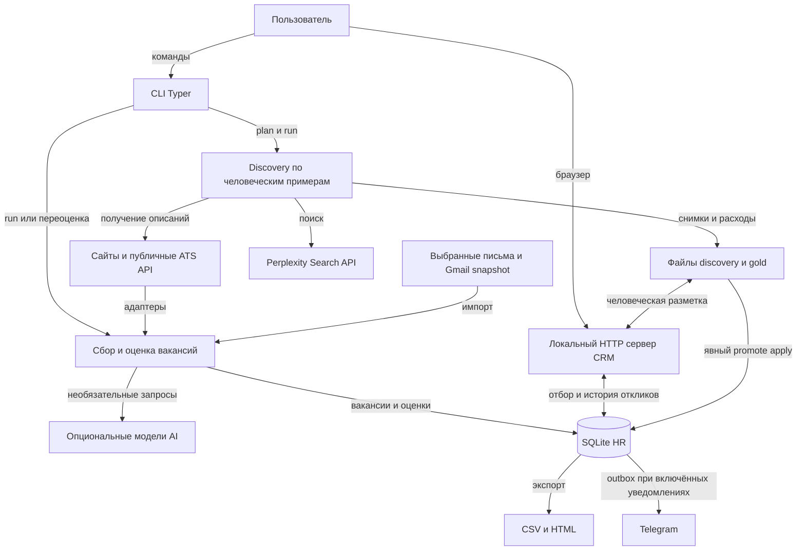

# Карта проекта HR Automation

[Документация](index.md) · [Сущности](entities.md) · [Методы](methods.md) ·
[Сценарии](workflows.md) · [Порядок чтения](reading-guide.md)

Проект — локальное Python приложение: команды Typer, SQLite через SQLAlchemy,
HTTP сервер CRM и браузерный интерфейс. Сбор и CRM запускаются вручную.
Отдельный контур discovery ищет новые примеры через Search API и сохраняет их
в файлы запуска до явного переноса в HR. Срез реализации — **19 октября 2026 года**.

## Назначение системы

1. Обеспечивать поток подходящих вакансий для следующей работы.
2. Обеспечивать поток вакансий для практики интервью с похожими задачами.
3. Сохранять объяснения решений и историю действий, чтобы ручной отбор и отклики
   можно было продолжать между запусками.

Полные приоритеты и владельцы карьерного контекста — в [AGENTS](../AGENTS.md).
Профили поиска задают исполняемые запросы и оценки; включённый профиль сам по себе
не означает карьерный выбор пользователя.

## Подсистемы и внешние связи



Стрелки показывают обмен данными, а не обязательный порядок вызовов. AI,
discovery и Telegram имеют отдельные настройки. Встроенного расписания и
автоматической отправки откликов нет.

## Основные каталоги

```text
HR-Automation/
├── README.md                  установка и подробные примеры использования
├── AGENTS.md                  приоритеты и маршрут к карьерному контексту
├── pyproject.toml             зависимости и команда job-intake
├── config/                    источники, профили, правила, настройки AI и CRM
├── src/job_intake/            исполняемый код
│   ├── cli.py                 корневая команда и группы команд
│   ├── pipeline.py            координация сбора и переоценки
│   ├── models/                объекты вакансии и оценки в памяти
│   ├── adapters/              преобразование источников в JobRecord
│   ├── config/                чтение и проверка настроек
│   ├── scoring/               доказательства, баллы, AI reranking, A/B/C
│   ├── annotation/            разметка, gold, проверка качества, когорты
│   ├── storage/               SQLite, идентичность, исходники, repair
│   ├── crm/                   отклики, импорт XLSX, HTTP и интерфейс
│   ├── discovery/             поиск кандидатов по положительным примерам
│   ├── alerts/                дайджест и доставка в Telegram
│   ├── review/                статический HTML отчёт
│   └── utils/                 HTTP, текст, CSV и логирование
├── scripts/                   отдельные служебные точки входа и инструменты
├── tests/                     проверки поведения на изолированных данных
├── docs/                      объяснения, справочники, протоколы и история
├── data/local/                приватная SQLite и локальные артефакты
├── reports/                   подготовленные отчёты
└── research_notes/            исследовательские материалы
```

`data/local/`, `.env`, `.venv/` и `.audit/` исключены из Git. Пути к данным
следует проверять по настройкам; подробнее — [сценарии](workflows.md).

## Ответственность модулей

| Область                         | Где находится                                                                                                                                                                          | За что отвечает                                                                                         |
| ------------------------------- | -------------------------------------------------------------------------------------------------------------------------------------------------------------------------------------- | ------------------------------------------------------------------------------------------------------- |
| Команды                         | [cli.py](../src/job_intake/cli.py)                                                                                                                                                     | Разбор параметров и выбор операции; подключение `crm`, `discovery`, `gold`, `eval`, `sources`, `repair` |
| Координация                     | [pipeline.py](../src/job_intake/pipeline.py)                                                                                                                                           | Обход источников, оценка, транзакции по вакансиям, завершение batch и outbox                            |
| Нормализация                    | [adapters](../src/job_intake/adapters/), [factory.py](../src/job_intake/adapters/factory.py)                                                                                           | DailyRemote, Greenhouse, Ashby, Lever, HTML, watchlist и письма                                         |
| Конфигурация                    | [settings.py](../src/job_intake/config/settings.py), [profiles.py](../src/job_intake/profiles.py)                                                                                      | Проверенные настройки и `SearchStream` с версией, правилами и scorer                                    |
| Профессия                       | [classification.py](../src/job_intake/classification.py), [occupation_titles.py](../src/job_intake/occupation_titles.py)                                                               | Одна метка роли; `other` для остальных и неясных ролей                                                  |
| Ограничения                     | [filtering.py](../src/job_intake/filtering.py)                                                                                                                                         | Обязательные препятствия, неопределённость и условия найма                                              |
| Соответствие роли               | [scoring](../src/job_intake/scoring/)                                                                                                                                                  | Доказанные обязанности, числовой score, ограничения категории и A/B/C                                   |
| Факты и качество                | [annotation](../src/job_intake/annotation/)                                                                                                                                            | Фрагменты исходника, claims, независимая проверка, gold, фиксированная оценка                           |
| Назначение вакансии             | [purpose.py](../src/job_intake/purpose.py)                                                                                                                                             | Отдельные machine/human решения для следующей работы и практики                                         |
| Сохранение                      | [storage](../src/job_intake/storage/)                                                                                                                                                  | ORM, upsert, дедупликация, версии исходников, aliases, история и outbox                                 |
| Рабочее состояние источников    | [source_state.py](../src/job_intake/storage/source_state.py), [source_lifecycle.py](../src/job_intake/storage/source_lifecycle.py), [sources_cli.py](../src/job_intake/sources_cli.py) | Согласование карточки с полным текстом, наблюдения досок и проверка состояния                           |
| Работа с откликами              | [crm](../src/job_intake/crm/)                                                                                                                                                          | Application, этапы, контакты, компании, импорт, API и интерфейс                                         |
| Расширение поиска               | [discovery](../src/job_intake/discovery/)                                                                                                                                              | План из примеров, поиск, получение текста, отбор, registry, разметка, расходы, promote                  |
| Выдача результата               | [review/report.py](../src/job_intake/review/report.py), [alerts](../src/job_intake/alerts/)                                                                                            | HTML отчёт и сообщения; CSV формирует репозиторий                                                       |
| Контролируемые изменения данных | [repair.py](../src/job_intake/storage/repair.py), [snapshot.py](../src/job_intake/storage/snapshot.py)                                                                                 | Снимок состояния и подготовка, применение, откат переоценки                                             |

## Путь одной вакансии по коду

Это маршрут обычного `run`; переоценка начинает с сохранённого текста, а не с сайта.

1. [build_adapter](../src/job_intake/adapters/factory.py) создаёт адаптер по
   `SourceDefinition`. `fetch_jobs` возвращает `JobRecord` и сведения о частичных ошибках.
2. [JobIntakePipeline._evaluate_record](../src/job_intake/pipeline.py) находит прежнюю
   запись и вызывает `reconcile_source`, чтобы краткая карточка не затёрла полное описание.
3. [RoleClassifier.classify](../src/job_intake/classification.py) выбирает одну роль.
   `RuleEngine.apply` применяет её правила; для неясной роли возможен AI вызов.
4. [VacancyPrefilter](../src/job_intake/annotation/prefilter.py) при включённом каскаде
   выбирает маршрут. [VacancyAnnotator](../src/job_intake/annotation/service.py)
   извлекает факты, затем ограничения уточняются по разметке.
5. [DeterministicScorer](../src/job_intake/scoring/pre_score.py) считает соответствие
   выбранной роли. Опциональный reranker добавляет свою оценку; `_finalize` обновляет
   условия найма и применяет ограничения A/B/C. Для `other` чужой профиль не оценивается.
6. `_save` передаёт результат в
   [JobRepository.upsert_evaluations](../src/job_intake/storage/repository.py).
   Вакансия, текущая оценка, события, прогноз назначения и outbox сохраняются
   транзакционно. Ошибка следующей вакансии не откатывает эту запись.
7. Отдельно обрабатываются результаты наблюдения источника и ожидающие уведомления.
   CRM и отчёты читают сохранённые результаты. Отклик возникает после действия пользователя.

Точные контракты и эффекты — в [методах](methods.md), отношения объектов — в
[сущностях](entities.md). Необходимые детали кешей и версий — в [архитектуре](architecture.md).

## Конфигурация и владельцы данных

| Файл или хранилище | Назначение |
| --- | --- |
| [settings.yaml](../config/settings.yaml) | Подключённые источники, путь SQLite, AI, предварительный каскад, Telegram, параметры CRM |
| [rules.yaml](../config/rules.yaml) | Общие правила и значения по умолчанию |
| [search_profiles.yaml](../config/search_profiles.yaml) | Стабильные ID профилей, запросы, контекст, переопределения правил и весов |
| [company_watchlist.yaml](../config/company_watchlist.yaml) | Доски компаний и параметры их адаптеров |
| [gmail_search.yaml](../config/gmail_search.yaml) | Настройки отбора писем для существующего процесса Gmail |
| [purpose_rubric.yaml](../config/purpose_rubric.yaml) | Декларация рубрики назначений; исполняемая логика и версия находятся в `purpose.py` |
| [llm_prompt.txt](../config/llm_prompt.txt), [eval_prices.yaml](../config/eval_prices.yaml) | Prompt reranker и таблица стоимости для оценочных процедур |
| SQLite HR | Вакансии, текущие оценки, назначения, отклики и история действий |
| JSONL gold и файлы discovery | Снимки источников, человеческие решения и результаты отдельных запусков |
| Карьерная база | Личный профиль, навыки, доказательства кейсов и принятые карьерные решения; [маршрут](../AGENTS.md#карьерный-контекст) |

## Где начинать изменение

| Задача | Код и связанные проверки |
| --- | --- |
| Добавить источник | `adapters/base.py`, `factory.py`, адаптер; [test_adapters.py](../tests/test_adapters.py), [test_source_health.py](../tests/test_source_health.py) |
| Исправить профессию | `classification.py`, `occupation_titles.py`; [test_role_classification.py](../tests/test_role_classification.py) |
| Исправить баллы или доказательства | `scoring`, `filtering.py`; [test_role_fit_scoring.py](../tests/test_role_fit_scoring.py), [test_scoring_evidence.py](../tests/test_scoring_evidence.py) |
| Изменить разметку или кеш | `annotation/service.py`, `input_contract.py`; [test_annotation_input_contract.py](../tests/test_annotation_input_contract.py), [test_source_reconciliation.py](../tests/test_source_reconciliation.py) |
| Изменить назначение или CRM | `purpose.py`, `crm/jobs.py`, `server.py`, `index.html`; [test_crm_purpose.py](../tests/test_crm_purpose.py), [test_crm_server.py](../tests/test_crm_server.py) |
| Изменить поиск по примерам | `discovery`; [test_discovery_service.py](../tests/test_discovery_service.py), [test_discovery_runtime_provenance.py](../tests/test_discovery_runtime_provenance.py) |
| Изменить сохранение и версии | `storage`, `pipeline.py`; [test_pipeline_profiles.py](../tests/test_pipeline_profiles.py), [test_p1_storage_operations.py](../tests/test_p1_storage_operations.py) |
| Изменить измерение качества | `annotation/frozen_eval.py`, `cohorts.py`; [test_frozen_evaluation.py](../tests/test_frozen_evaluation.py) |

Перед изменением исполняемых критериев нужен маршрут карьерного контекста из
[AGENTS](../AGENTS.md), а перед изменением Perplexity —
[инструкция интеграции](perplexity-search-integration.md). Правила не изменяются
самим обновлением этой карты.
